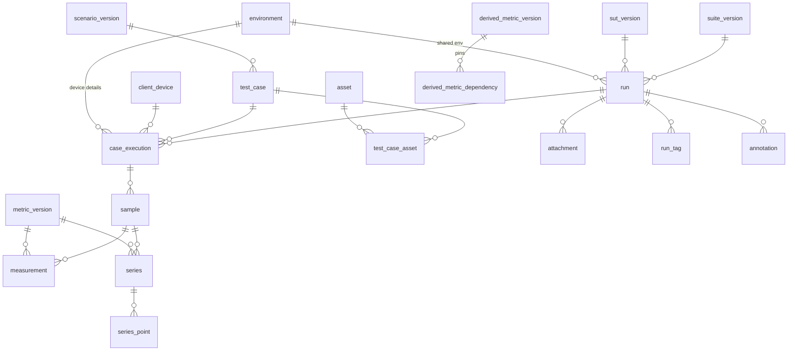

# Database

PostgreSQL 18 schema, migration runner, database image and pgTAP tests.
Design decisions are in [ADR 0004](../docs/adr/0004-database-schema.md)
(schema) and [ADR 0006](../docs/adr/0006-database-image.md) (image and
migrations).

## Layout

```
db/
  migrations/      Numbered SQL migrations, applied in order, one transaction each
  migrate.sh       Applies pending migrations (track-record-migrate in the image)
  Dockerfile       Database image: postgres:18 plus migrations and runner
  image/           Files copied into the image
  image-test.sh    Builds the image and checks it
  tests/           pgTAP tests, one file per area
  tests/lib/       Shared test fixtures (included with \ir)
  test/            Docker image and script for the test run
  test.sh          Runs the tests
```

## Migrations

`migrate.sh` applies the migrations that are not applied yet, in version
order, each in its own transaction. Applied migrations are recorded in
`schema_migration` with a SHA-256 checksum. The script stops with an error if
an applied migration has changed or is missing, so never edit a merged
migration: add a new one. Several runs at once are safe.

It connects through the standard libpq variables and needs `psql`:

```bash
PGHOST=localhost PGUSER=postgres PGDATABASE=track_record db/migrate.sh
```

## Database image

```bash
docker build --tag track-record-db db
```

Run it as the database server. On first start with an empty data directory,
all migrations are applied to `track_record` (`POSTGRES_PASSWORD` is
required, as in the `postgres` image):

```bash
docker run --detach --name track-record-db --env POSTGRES_PASSWORD=secret \
    --publish 5432:5432 --volume track-record-data:/var/lib/postgresql track-record-db
```

Run it as a migration job against an existing database, e.g. after an
upgrade. A restarted server does not migrate by itself:

```bash
docker run --rm --env PGHOST=db.example --env PGUSER=postgres \
    --env PGPASSWORD=secret --env PGDATABASE=track_record \
    track-record-db track-record-migrate
```

`db/image-test.sh` builds the image and checks first start, a rerun that
applies nothing, refusal of changed and missing migrations, and an upgrade.

## Running the tests

Needs Docker. The script builds a PostgreSQL 18 image with pgTAP, applies all
migrations to a throwaway database with `migrate.sh` and runs every test file
with `pg_prove`:

```bash
db/test.sh
```

Run selected files (paths inside the container):

```bash
db/test.sh /db/tests/04_runs.sql
```

Each test file runs in a transaction that is rolled back, so tests are
independent.

## Schema overview



| Area | Tables | Notes |
|---|---|---|
| Definitions | `suite[_version]`, `scenario[_version]`, `metric[_version]`, `derived_metric[_version]`, `derived_metric_dependency`, `alias[_version]` | Immutable versions. Create through `ensure_*`, `save_derived_metric`, `set_alias`. A derived metric version pins the versions it uses. Alias values are JSON scalars. |
| Units | `unit` | Predefined units with conversion factors (FR-13a). Grows only through migrations. Other unit symbols are allowed anywhere but are not converted. |
| Dimensions | `sut_version`, `environment`, `client_device`, `asset`, `test_case`, `test_case_asset` | Deduplicated, immutable. Create through `ensure_*`. Numeric parameters can carry a unit (`test_case.parameter_units`). |
| Results | `run`, `case_execution`, `sample`, `measurement`, `series`, `series_point`, `attachment` | Client UUIDs, immutable. Only run status/end time/validity change. Raw values only: one series per sample and metric, x never decreases. |
| Editable | `run_tag`, `test_case_tag`, `annotation`, `api_token` | Normal updates and deletes. |

Views: `current_case_execution` (hides superseded corrections),
`current_alias`, `latest_derived_metric_version`.

Lifecycle functions: `abort_stale_runs(timeout)`, `run_last_upload_at(run_id)`,
`delete_run(run_id)`. A run is stale when nothing was uploaded for it within the
timeout, in server time (`created_at` columns). The measured `run.started_at`
never counts, so late uploads and imports are safe (FR-2).

Units: `unit_conversion_factor(from, to)` returns the factor between two units
of the same quantity, or `NULL` if they cannot be converted.

## Error codes

Custom SQLSTATEs raised by the schema, for the backend to map to API errors:

| Code | Meaning |
|---|---|
| `TR001` | Row is immutable (update or truncate rejected) |
| `TR002` | Delete outside `delete_run()` |
| `TR003` | Invalid run status transition |
| `TR004` | Run is not running (new case execution rejected) |
| `TR005` | Series points don't match `point_count` |
| `TR006` | Series x values decrease |
| `TR007` | Derived metrics would form a cycle |

Standard codes also matter: `23505` (duplicate, e.g. a retried upload),
`23503` (foreign key), `23514` (check constraint).
